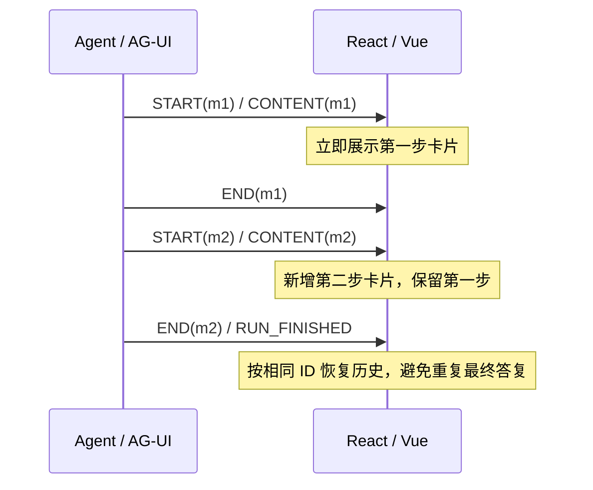

# EliteForge Agent UI 接入指南

本文说明如何在 Web 与 React Native 应用中接入公共聊天组件和终端组件。组件负责界面和交互；宿主应用负责业务 API、认证，以及服务端运行环境。

## 1. 选择要接入的包

| 需求 | 使用的包 | 宿主需要提供 |
|---|---|---|
| React 聊天界面 | `@personai/agent-ui-chat-react` | `ChatAdapter` |
| React Native 聊天界面 | `@personai/agent-ui-chat-react-native` | RPC/AG-UI 客户端，产出 `ChatMessage` |
| React Native A2UI 渲染 | `@personai/agent-ui-a2ui-react-native` | `A2UIClient` |
| React Native 平台无关逻辑 | `@personai/agent-ui-chat-core/headless` | 事件与消息映射 |
| Vue 3 聊天界面 | `@personai/agent-ui-chat-vue` | `ChatAdapter` |
| 聊天数据类型和协议处理 | `@personai/agent-ui-chat-core` | React/Vue 聊天包会依赖它 |
| 聊天主题 | `@personai/agent-ui-chat-theme` | 按需覆盖 CSS 变量 |
| 浏览器终端 | `@personai/agent-ui-terminal` | `TerminalTransport`；AI 功能还需 `AITransport` |

组件不会直接调用宿主的会话 API 或 Agent API。`chat-core` 定义公共数据类型和 `ChatAdapter` 接口；宿主实现 adapter，在自己的 API 与这些公共类型之间转换：

```text
React / Vue 聊天组件
        ⇅ 调用 / 接收 ChatAdapter
宿主实现的 ChatAdapter
        ⇅ 请求 API，并映射宿主实体和事件
宿主会话、消息、Agent 和 AG-UI 服务

Terminal 组件
        ⇅ TerminalTransport / AITransport 接口
传输实现（包内提供默认实现，也可由宿主实现）
        ⇅ Socket.IO / SSE 或宿主自定义协议
宿主 PTY 服务 / Agent 服务
```

`ChatSession`、`ChatMessage`、`ChatSendResult` 和 AG-UI 事件类型是 chat-core 的公共 UI 契约，不是宿主数据库实体。宿主 adapter 负责双向转换。`ChatModelSelection` 只描述发送给宿主 Agent 的模型选择信息；框架不提供模型厂商 SDK 或模型调用层。

终端包定义 `TerminalSession`、`TerminalTransport` 和 `AITransport` 契约，也提供 Socket.IO PTY 和 SSE AI 的默认客户端。宿主服务符合默认协议时可直接使用；协议不同则由宿主实现对应接口并转换数据。PTY 进程必须由宿主服务端创建、隔离和回收，浏览器组件不会启动 shell 进程。

## 2. 安装

这些包通过 `@personai` 作用域发布到公共 npm。在消费项目配置 `.npmrc`：

```ini
@personai:registry=https://registry.npmjs.org/
```

按需安装并固定同一版本。以下以当前仓库版本 `1.0.0-preview.31` 为例；升级时同时更新所有使用的 Agent UI 包和锁文件。React 聊天示例：

```sh
npm install --save-exact @personai/agent-ui-chat-react@1.0.0-preview.31 @personai/agent-ui-chat-core@1.0.0-preview.31 @personai/agent-ui-chat-theme@1.0.0-preview.31
```

Vue 聊天示例：

```sh
npm install --save-exact @personai/agent-ui-chat-vue@1.0.0-preview.31 @personai/agent-ui-chat-core@1.0.0-preview.31 @personai/agent-ui-chat-theme@1.0.0-preview.31
```

终端示例：

```sh
npm install --save-exact @personai/agent-ui-terminal@1.0.0-preview.31
```

安装时还要满足对应包声明的 React、Vue 和 xterm peer dependencies。chat-theme 包含全局根色板与页面样式；已有设计系统可省略该包及其 import，改为提供公开 CSS 变量。终端安装脚本会修补 xterm 输入法行为，使用受限安装脚本策略时应核查并允许该包所需脚本。

## 3. 接入聊天组件

### 3.1 先用模拟宿主验证界面

`createMockChatAdapter()` 会在内存中创建会话、回显消息并生成模拟 AG-UI 事件，不需要后端。

React：

```tsx
import { ChatRuntimeWindow } from "@personai/agent-ui-chat-react";
import { createMockChatAdapter } from "@personai/agent-ui-chat-core";
import "@personai/agent-ui-chat-theme";
import "@personai/agent-ui-chat-react/styles.css";

const adapter = createMockChatAdapter();

export function ChatPage() {
  return (
    <ChatRuntimeWindow
      adapter={adapter}
      config={{ floating: false, title: "项目助手" }}
    />
  );
}
```

Vue 3：

```vue
<script setup lang="ts">
import { ChatRuntimeWindow } from "@personai/agent-ui-chat-vue";
import { createMockChatAdapter } from "@personai/agent-ui-chat-core";
import "@personai/agent-ui-chat-theme";
import "@personai/agent-ui-chat-vue/styles.css";

const adapter = createMockChatAdapter();
</script>

<template>
  <ChatRuntimeWindow
    :adapter="adapter"
    :config="{ floating: false, title: '项目助手' }"
  />
</template>
```

### 3.2 对接宿主的聊天服务

真实接入时，用宿主实现的 adapter 替换模拟 adapter。`ChatAdapter` 负责把宿主协议转换成 chat-core 的通用数据类型。

| Adapter 方法 | 用途 |
|---|---|
| `createSession(input)` | 创建会话并返回 `ChatSession` |
| `deleteSession(sessionId)` | 删除会话 |
| `loadMessages(sessionId)` | 加载会话消息，返回 `ChatMessage[]` |
| `loadAguiEvents(sessionId)` | 加载会话级 AG-UI 事件，返回 `ChatAguiEvent[]` |
| `streamMessage(session, input, handlers, signal)` | 向 Agent 发送消息并返回 `ChatSendResult` |

`streamMessage` 收到文本片段时调用 `handlers?.onDelta(delta)`；收到 AG-UI 流事件时调用 `handlers?.onAguiEvent(event)`。把宿主的会话、消息、事件和最终运行结果分别映射成 `ChatSession`、`ChatMessage`、`ChatAguiStreamEvent` 和 `ChatSendResult`。

有 AG-UI 消息 ID 时，必须保留每个步骤的 `TEXT_MESSAGE_START`、`TEXT_MESSAGE_CONTENT`、`TEXT_MESSAGE_END` 及其 `messageId`，并及时转发。React/Vue 使用同一个 `AssistantMessageStream` 按 ID 创建卡片；结束前的增量只更新当前步骤，结束后下一步创建新卡片。相同 ID 用于结构化历史，不能等整个运行结束后再拆分文本。



`onDelta` 继续兼容没有消息 ID 的旧适配器。同一片段同时触发两种回调时，先转发 `onAguiEvent`，再调用 `onDelta`；组件识别协议消息后会忽略镜像的裸文本回调，避免追加两次。流式打字效果按每个卡片处理，消息结束时显示剩余文本，不阻塞下一步。

最小 adapter 骨架：

```ts
import type { ChatAdapter } from "@personai/agent-ui-chat-core";

export const adapter: ChatAdapter = {
  capabilities: {
    supportsAbort: true,
    supportsAgui: true,
    supportsProtocolReplay: false,
    supportsStreaming: true,
  },

  async createSession(input) {
    return mapSession(await hostApi.createSession(input));
  },
  async deleteSession(sessionId) {
    return mapSession(await hostApi.deleteSession(sessionId));
  },
  async loadMessages(sessionId) {
    return (await hostApi.loadMessages(sessionId)).map(mapMessage);
  },
  async loadAguiEvents(sessionId) {
    return (await hostApi.loadAguiEvents(sessionId)).map(mapAguiEvent);
  },
  async streamMessage(session, input, handlers, signal) {
    const result = await hostApi.streamMessage(session.sessionId, input, {
      signal,
      onDelta: (delta) => handlers?.onDelta?.(delta),
      onEvent: (event) => handlers?.onAguiEvent?.(mapStreamEvent(event)),
    });
    return mapSendResult(result);
  },
};
```

`hostApi` 和 `map*` 是宿主代码：按自己的 API 实现请求和数据转换。不要直接把产品响应对象当作 chat-core 类型返回。

只有后端确实支持时，才开启可选能力：

- `supportsProtocolReplay: true` 时提供 `loadProtocolEvents(sessionId)`。
- `supportsActiveRun: true` 时提供 `getActiveRun(sessionId)`。
- `supportsStop: true` 时提供 `stopRun(session, context)`。该方法必须调用后端停止运行；只中断浏览器流不会停止 Agent。
- `supportsSteer: true` 时提供 `steerMessage(...)`。
- 要启用附件上传或下载，实现 `uploadAttachment` 或 `downloadAttachment`。要启用用户输入请求，设置 `supportsUserInputRequests: true`，并实现 `loadUserInputRequests` 和 `answerUserInputRequestStream`。
- 要展示消息交付文件，实现 `artifactAction` 和 `artifactContentUrl`，并按需声明 `supportsArtifacts: true`；详见下一节。

把 adapter 传给聊天组件：

```tsx
<ChatRuntimeWindow
  adapter={adapter}
  config={{ floating: false, title: "项目助手" }}
  currentUserDisplayName="访客"
  onSessionChange={(session) => saveCurrentSession(session)}
/>
```

`ChatRuntimeWindow` 管理常见会话与运行状态。宿主要完全控制状态时可使用 `ChatPanel`；要在可移动、可调整大小的悬浮窗中显示聊天时可使用 `ChatWindow`。React 和 Vue 都使用同一个 `ChatAdapter` 类型。

设置 `config.hideMessageIdentity: true` 可隐藏消息和交互回执中的发送者名称及头像；默认值为 `false`。时间、消息操作和消息数据不受影响。直接使用 `ChatPanel` 或 `ChatWindow` 时，通过同名 `hideMessageIdentity` 属性控制。

### 3.3 交付文件（Artifacts）

完成的助手消息可以在 `ChatMessage.artifacts` 上携带一组已交付文件。宿主已经完成合并、去重和按客户端解析动作；UI 只按顺序渲染，不接收文件路径或 `source` 对象：

```ts
interface ChatArtifacts {
  version: "v1";
  items: ChatArtifactItem[];
}
```

- `actions` 是权威列表，只接受 `preview`、`open`、`reveal`、`save`；`actions[0]` 是主按钮，其余进入溢出菜单。缺省或空数组表示只展示、不显示按钮。
- 未知 `version`、非数组 `items` 或缺少 `id` / `display` 的条目不会渲染；`parseArtifacts` 防御式解析且从不抛错。空 `items` 不渲染。
- 条目已由宿主合并去重，组件保持原顺序。超过 `ARTIFACT_COLLAPSED_COUNT`（4）项时折叠，并提供“全部 N 项 / 收起”切换。
- `states` 按条目 id 标记 `pending` / `failed`；失败时显示重试，重试重复上次动作（没有历史动作时使用主按钮）。

adapter 新增可选的交付文件能力。只有后端和当前客户端都能处理实际动作时才声明 `supportsArtifacts`：

| 方法 | 用途 |
| --- | --- |
| `artifactAction(session, { runId, itemId, action }, signal)` | 执行 `open` / `reveal` / `save`，返回 `completed`、`cancelled` 或 `failed` |
| `artifactContentUrl(session, { runId, itemId, disposition })` | 解析内容 URL；`inline` 用于预览，`attachment` 用于下载 |

`ChatRuntimeWindow` 从 adapter 自动派生回调：预览用 `artifactContentUrl(..., "inline")` 在新标签页打开；动作结果驱动 `pending` / `failed`。`onArtifactPreview` 可替换预览方式，`onArtifactAction` 在 adapter 完成后回调。直接使用 `ChatPanel` 时必须自己传 `onArtifactAction`、`onArtifactPreview` 和 `artifactStates`；`artifactLabels` 可覆盖标题、折叠、重试、动作、大小与类型文案。

```text
ChatMessage.artifacts (v1)
        │ parseArtifacts（未知版本/畸形 → 不渲染）
        ▼
ChatArtifacts ── actions[0] → 主按钮；actions[1..] → 溢出菜单
        │ onAction
        ▼
ChatRuntimeWindow ── adapter.artifactAction ── 宿主执行
        │
        └─ artifactContentUrl(inline) → 预览新标签页（RN 无此能力）
```

React/Vue 组件属性相同：`artifacts`、`onAction`、`onPreview`、`labels`、`locale`、`states`。React Native 使用 `ArtifactList`（由 `MessageBubble` 自动挂载），动作以内联按钮行展示，不打开 URL；没有宿主提供的 `onPreview` 时不显示预览。该能力属于当前源码，消费方需安装包含此变更的 npm 版本后生效。

### 3.4 React Native

React Native 宿主不实现 `ChatAdapter`（它绑定 Web 流式请求），改用 RPC/Noise 隧道拿 AG-UI 事件，再把事件转换为 `chat-core/headless` 的 `ChatMessage`、`ChatUserInputRequest` 和 `ChatA2uiSession`：

```tsx
import { ChatPanel } from "@personai/agent-ui-chat-react-native";
import type { ChatMessage } from "@personai/agent-ui-chat-core/headless";

<ChatPanel
  draft={draft}
  messages={messages}
  onAnswerUserInput={(answers) => tunnel.call("session.answer", answers)}
  onDraftChange={setDraft}
  onSend={() => sendDraft()}
  sending={running}
  userInputRequests={requests}
/>;
```

`@personai/agent-ui-chat-core/headless` 只导出平台无关模块（消息、转录、AG-UI、工具展示、历史、A2UI 交互、交付文件解析），不会引入 `mermaid`、DOM 或 CSS。完整 API、Catalog 映射和主题 token 见 [React Native 聊天与 A2UI](react-native.md)。

## 4. 接入终端

终端包渲染终端、Shell 命令块和可选的 AI 交互。传输由宿主提供，组件初始化时会连接终端服务：

```ts
import {
  createAITransport,
  createTerminalTransport,
  initTerminal,
} from "@personai/agent-ui-terminal";
import "@personai/agent-ui-terminal/styles.css";

const terminal = initTerminal({
  el: document.querySelector<HTMLElement>("#terminal")!,
  transport: {
    terminal: createTerminalTransport({
      url: "https://your-app.example.com/terminal",
    }),
    ai: createAITransport({
      url: "https://your-app.example.com/api/assistant/stream",
      headers: () => ({
        Authorization: `Bearer ${getAccessToken()}`,
      }),
    }),
  },
  locale: "zh-CN",
  onExit: (code) => closeTerminalTab(code),
  onError: (error) => reportError(error),
});

// 组件卸载或标签页关闭时调用
terminal.dispose();
```

`1.0.0-preview.3` 起，返回实例提供 `clear()`、`getSelection()` 和 `focus()`，用于 xterm 清屏、读取选中文本和聚焦输入；详见终端包 README。`1.0.0-preview.2` 不包含这些方法。

AI 是可选的：省略 `ai` 后，普通终端仍可使用。`createTerminalTransport` 使用 Socket.IO 连接 PTY 服务；若现有服务不是兼容协议，请实现并注入 `TerminalTransport`。若要自定义 AI 通信方式，实现 `AITransport` 的 `request` 和 `stream` 方法。

终端活动区保留原生 `<details>` 交互：思考、工具组和单个工具在运行中即可展开/收起，流式事件只更新内容，不重置用户选择的展开状态，运行结束时也不自动折叠。展开后显示工具参数与已返回结果。接入验收应在真实后端覆盖：工具运行中可展开、工具结束但整轮未结束时仍可展开、新事件到达后已展开项保持打开，以及“终止会话”、主题切换、终端输入和资源释放无回归。

终端服务至少要负责认证用户、授权工作目录、安全创建 PTY、限制资源并在会话结束时回收进程。不要把 shell 启动权限或服务端凭据放进浏览器代码。`dispose()` 会释放终端、传输和未完成的 AI 请求。

## 5. 主题、文案和布局

当前源码中，用户消息和正文答复下方的操作按钮、时间在桌面端悬停到对应消息或键盘聚焦时显示，隐藏时保留占位。触屏等不支持 hover 的设备保持可见。React/Vue 使用一致规则；过程区和系统通知不受影响。此行为从 `1.0.0-preview.4` 开始提供。

React 和 Vue 聊天消息都支持 fenced `mermaid` 代码块，按需加载 Mermaid，并使用当前聊天主题的字体和颜色。流式消息在代码块闭合后渲染图表；未闭合或语法错误时保留源码。普通代码块保持原样。

AG-UI 正文始终显示为独立消息，包括未声明 `phase` 的模型输出。思考与工具按相邻正文分段；正文出现时结束前面的过程段，后续过程接在正文后面，不会把先前回复重新收进折叠区。运行中的尾部过程展开，已结束的过程可展开查看。正文中的 `Reasoning` 块仍进入过程区，不会作为正文展示。直播、回放与结构化历史使用相同的规则。

```text
用户输入 → 思考/工具过程（可折叠）→ 正文 → 后续过程（可折叠）→ 正文
```

`TEXT_MESSAGE_END` 仅关闭一条消息；只有执行成功才标记最终结果。失败、取消和等待输入时保留已经收到的正文，不将其误标为成功答案。过程分组保持稳定身份，后续事件不会清除用户主动展开或收起的选择。

“准备请求”只用于本次发送或交互回答尚未收到执行事件的阶段；收到运行开始、思考、正文、工具或终止事件即结束准备状态，不需要等待正文或整个运行完成。旧的回放事件不会确认一个新请求。

合并直播和回放时按稳定事件 ID 去重。带 `metadata.framework.executionId` 与 `sourceSequence` 的帧在各自执行内优先按源序号排列；没有序号的帧沿用时间戳和输入顺序。续跑可以有新的执行 ID，序号允许重新开始。工具按调用 ID 关联，避免历史记录和直播结果重复。

A2UI Surface 恢复产生的展示消息通常没有 `history`，应沿用同一运行的状态。`1.0.0-preview.4` 已修复这类消息导致“工作中”残留的问题。没有权威历史或结束事件时，不能仅凭图表已渲染就视为完成；等待输入与新的执行事件仍按原生命周期处理。

```text
SessionHistory ── 同一 runId 的结束状态 ──┐
                                         ├─ 工作过程状态 → 停止计时、显示最终答复
A2UI Surface ─── 只补充展示消息 ──────────┘
```

子代理派发卡片使用 `workRailLabels.tool.subagentDispatched(name)` 生成标题；`name` 从 `agent_spawn` 的参数或子代理事件字段中读取。未提供回调时，界面根据已有 `workRailLabels` 文案判断中英文并生成标题。`agent_spawn` 工具行不再重复显示运行状态文字。

点击图表或聚焦后按 Enter/空格，可打开带遮罩的大图预览，支持放大、缩小和适应窗口。按 Esc、点击关闭按钮或遮罩可关闭，焦点返回原图表。历史消息使用同一渲染和预览能力。

渲染使用 [Mermaid strict 安全配置](https://mermaid.js.org/config/usage.html)，禁用 HTML 标签和图内跳转脚本，消息内容不能覆盖安全配置。

- 聊天主题：先引入 `@personai/agent-ui-chat-theme`，再用 CSS 变量覆盖颜色和边框。
- React 聊天组件提供 `headerContent`、`sidebarContent`、`footerAddon` 等扩展点；Vue 组件提供对应插槽。
- 终端可通过 `terminalOptions.themeTokens`、其他 `terminalOptions`、`locale` 和 `messages` 设置终端外观及文案。
- 聊天历史时间轴在视口宽度不超过 900px 时自动隐藏。

## 6. 本地调试

在仓库根目录安装依赖后，可分别启动各包的模拟宿主页面：

```sh
npm install
npm run dev --workspace @personai/agent-ui-chat-react
npm run dev --workspace @personai/agent-ui-chat-vue
npm run dev --workspace @personai/agent-ui-terminal
```

这些命令分别启动 React 聊天、Vue 聊天和终端演示。模拟 adapter 只用于界面与交互验证，不会连接产品 API，也不能替代生产环境的宿主 adapter 和服务端。

## 7. 相关文档

- [React 聊天包说明](../packages/chat-react/README.md)
- [Vue 聊天包说明](../packages/chat-vue/README.md)
- [React Native 聊天包说明](../packages/chat-react-native/README.md)
- [React Native A2UI 渲染器](../packages/a2ui-react-native/README.md)
- [React Native 聊天与 A2UI](react-native.md)
- [终端包说明](../packages/terminal/README.md)
- [仓库包结构与开发命令](../README.md)

## 宿主迁移时保留的契约

宿主将自己的 Code 字段映射为 UI 的 Id 字段时，须同步处理历史消息、实时事件、主动运行状态、用户问题、附件和恢复回答。
尤其是 `resume[].payload.answers` 中的 question/option 标识，不能只转换外层 `answers`。
宿主扩展字段可放在 `metadata` 中；转换后的 metadata 不代替后端权限检查。

运行中的发送策略依赖结构化错误码。宿主应将其“运行已存在/steer 不可用”等错误映射为公共 `ChatAdapterError` 的相应代码，
并保留 HTTP 状态、错误详情、AbortSignal 与预期 run 标识。不能仅抛普通 Error 导致队列误判。

React/Vue 聊天组件提供 `data-theme-anchor="chat"`、`chat-input`、`chat-message` 和 `dialog` 的宿主主题锚点，
同时保留 `data-theme-part`。摘要栏只使用公开 reasoning summary；已结束的空 reasoning 若拥有工具卡片仍保留，
避免终端过滤 reasoning 时一并丢掉工具执行结果。

Tron 的初始接入使用公共 chat 与 terminal 渲染器，Tron 自己维护 `@tron/chat-agent-ui-adapter`、认证、业务 API 和服务端 PTY。
公共项目修复需要在这里验证后由宿主更新依赖；不能让宿主复制渲染器。宿主通过 npm 安装统一的明确版本，不依赖本地 Agent UI 源码目录或 `.agent-deps/agent-ui` 软链接。

### Compaction block details (since 1.0.0-preview.5)

`ChatCompactionBlock` contains `id`, `beforeTokens`, `afterTokens` and `kind`
(`compressed` or `summary`). A reduction must lower its token count; generated
summaries are reported separately. Do not infer reductions from budgets or list
unchanged blocks as compressed.

Live hosts send `CUSTOM agent.memory.compaction.details` with `{ blocks }` after
assembly, associated with the same run as the compaction lifecycle. Completion
may also carry `{ blocks }`. Detail events do not finish a run or create a notice
without a compaction lifecycle. For durable history, provide
`HistoryStep.compaction = { blocks }` on the corresponding compaction step.
Match the run and step interval; never attach the session's latest snapshot to
older steps. Omitted details mean unavailable; `[]` means no confirmed changes.

React and Vue use a keyboard-accessible native disclosure for finished notices.
Use `labels.notices.compactionBlock(block)` to translate block names/results;
`compactionNoChanges` and `compactionDetailsUnavailable` translate empty states.

```text
assembler facts → live detail + lifecycle → disclosure
saved step + matching report → history step.compaction → same disclosure
```

### 运行诊断（since 1.0.0-preview.29）

宿主可以在终止失败的 `RUN_ERROR` 事件上附带 `diagnostic`。chat-core 会校验后把它带到 `AguiRunNotice` 的 `runError` 分支，React/Vue 在失败通知中渲染 Trace ID 和链路入口；没有诊断时不渲染空行，取消运行不显示诊断。

```ts
onAguiEvent: (event) => handlers?.onAguiEvent?.(event.type === "RUN_ERROR"
  ? { ...event, diagnostic: { traceId: run.traceId, href: `/traces?traceId=${encodeURIComponent(run.traceId)}` } }
  : event);
```

- `traceId` 只接受 `[A-Za-z0-9][A-Za-z0-9._:-]{0,127}`。适配层可先用 `parseChatRunDiagnostic(value)` 校验并归一化。
- `href` 必须是同源绝对路径（以单个 `/` 开头）。绝对 URL、`//host`、反斜杠和控制字符会被丢弃，只保留 Trace ID；库不会把宿主输入渲染成脚本链接。
- 文案通过 `workRailLabels.notices.traceId(traceId)` 和 `viewTrace` 翻译，默认是 `Trace ID: <id>` 和 `View trace`。
- React `ChatRuntimeWindow` / `ChatPanel` 提供 `renderRunNoticeExtra(notice)`，在内置诊断行之后追加宿主内容；Vue 使用相同 labels，不提供函数插槽。

```text
RUN_ERROR + diagnostic → chat-core 校验 → runError notice → 内置 Trace ID + 链接 → renderRunNoticeExtra
```

诊断来自事件，历史投影的 `HistoryRun.error` 不包含 trace 信息。宿主若要在刷新后仍保留链路入口，需要在历史响应中携带自己的诊断字段，或继续通过协议事件回放恢复。

### 图片附件与历史回放

图片附件和结构化历史中的 `Media` 图片默认使用紧凑缩略图，点击后通过 ChatPanel 的图片预览层查看原图，可用关闭按钮或 Escape 退出。批注图片保留原始 URL、内容和元数据，不把缩略图尺寸传给模型，也不修改历史记录。实时附件与重新加载的历史使用相同的尺寸变量。

- `--agent-ui-chat-image-thumbnail-width`：默认 `112px`。
- `--agent-ui-chat-image-thumbnail-height`：默认 `80px`。
- `--agent-ui-chat-image-thumbnail-radius`：默认 `10px`。

这些变量可以从宿主容器继承；历史图片入口提供 `data-theme-part="chat-image-thumbnail"`。普通媒体图片采用同样的紧凑展示。此行为属于当前源码，消费方需安装包含该修复的发布版本后生效。

用户历史图片与实时附件归入对应用户消息组，缩略图位于消息正文上方并沿右边缘对齐；多张图片自动换行，点击仍打开原图预览。助手和系统消息不使用用户消息的右对齐分组。

批注弹层挂到 body 时复制来源聊天的主题颜色；保存按钮使用 `--agent-ui-chat-primary` / `--agent-ui-chat-on-primary`（回退到宿主 `--color-primary` / `--color-on-primary`），悬停混合主题色，禁用态不触发悬停变化。

工作栏从 `1.0.0-preview.7` 起使用前端单调时钟持续计时，事件只提供装载时的历史基线；等待回答时暂停，确认回答后恢复，完成或停止后固定。宿主保留已回答请求的 `answeredAt` 与运行身份，使旧暂停状态能被正确清除。

## 工具分组总数

当前源码中，React/Vue 工具分组标题只显示已开始的工具调用总数，使用 `workRailLabels.tool.group(count)`，例如“13 个工具调用”；失败的调用也计入总数，一次批量调用计为一次。分组不再按命令、搜索、读写或其他操作分类统计，旧 `groupSummary` 回调保留类型兼容但不再调用。展开后的工具明细保持原有展示。消费方需安装包含此变更的 npm 版本后生效。
